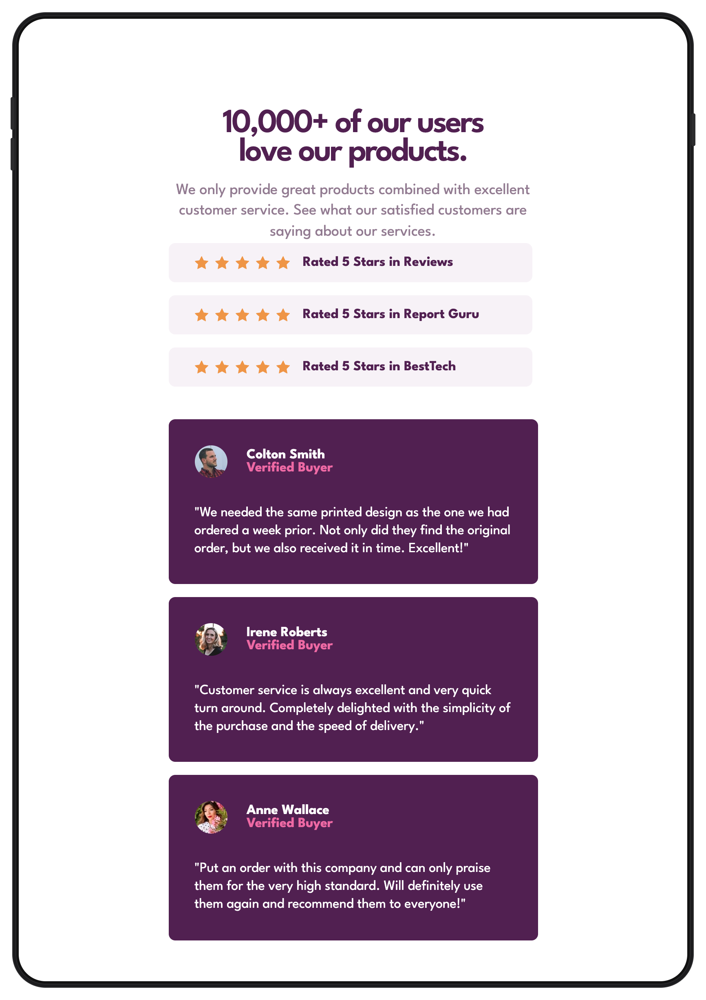
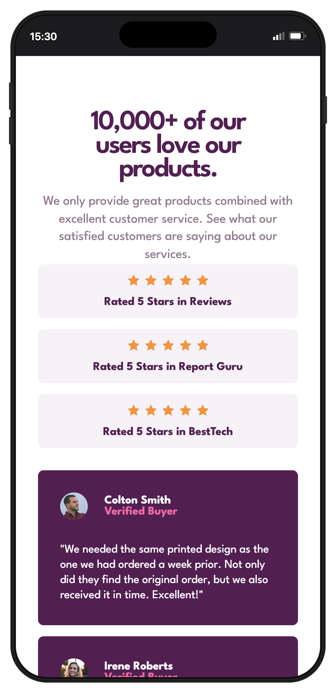

# Frontend Mentor - Social proof section solution

This is a solution to the [Social proof section challenge on Frontend Mentor](https://www.frontendmentor.io/challenges/social-proof-section-6e0qTv_bA). Frontend Mentor challenges help you improve your coding skills by building realistic projects.

## Table of contents

- [Overview](#overview)
  - [The challenge](#the-challenge)
  - [Screenshot](#screenshot)
  - [Links](#links)
- [My process](#my-process)
  - [Built with](#built-with)
  - [What I learned](#what-i-learned)
  - [Continued development](#continued-development)
  - [Useful resources](#useful-resources)
  - [AI Collaboration](#ai-collaboration)
- [Author](#author)
- [Acknowledgments](#acknowledgments)

## Overview

### The challenge

Users should be able to:

- View the optimal layout for the section depending on their device's screen size

### Screenshot

#### Desktop

.png>)

#### Mobile Devices

### Links

- GitHub Repo: [Social Proof Section Repo](https://github.com/jonmc89/social-proof-section-master)
- Live Site URL: [Demo](https://jonmc89.github.io/social-proof-section-master/)

## My process

### Built with

- Semantic HTML5 markup
- CSS custom properties
- Flexbox
- Mobile-first workflow

### What I learned

N/A

### Continued development

N/A

### Useful resources

N/A

### AI Collaboration

N/A

## Author

- Website - [jonmckenziewebdev.co.uk](https://jonmckenziewebdev.co.uk/)
- Frontend Mentor - [@jonmc89](https://www.frontendmentor.io/profile/jonmc89)
- GitHub - [@jonmc89](https://github.com/jonmc89)

## Acknowledgments

N/A
